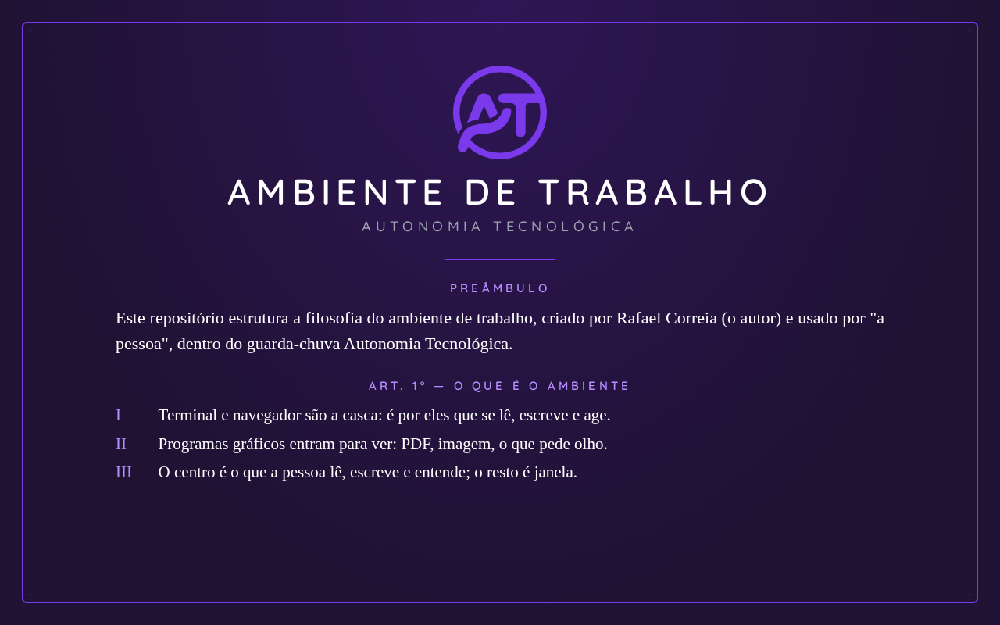

# ambiente-de-trabalho

Este repositório estrutura a filosofia do ambiente de trabalho, criado por Rafael Correia (o autor) e usado por "a pessoa", dentro do guarda-chuva
Autonomia Tecnológica: o que é o ambiente, o que une o AT, o Produtividade e o ai-tmux-workspace,
e as premissas que valem para todos eles. Ele não tem código; é o texto que os outros repositórios
citam, e que vale sobre eles. Ele é escrito para LLMs, e humanos também podem lê-lo.

O texto: [`docs/pt_BR/filosofia.md`](docs/pt_BR/filosofia.md).
